<p align="center">
  
</p>

<details>
<summary><code>youssef@inpt:~$ ls -a</code> &nbsp;(there's a hidden file)</summary>

```console
youssef@inpt:~$ ls -a
.  ..  .bashrc  .flag  projects  writeups  certs

youssef@inpt:~$ cat .flag
SU5QVHtsaW5rZWRpbi5jb20vaW4veW91c3NlZi1sYWFyeWVjaH0gZ2xhZCB0byBjb25uZWN0IHdpdGggeW91IQ==

# decode it. you know how.
```

</details>

<p align="center">
  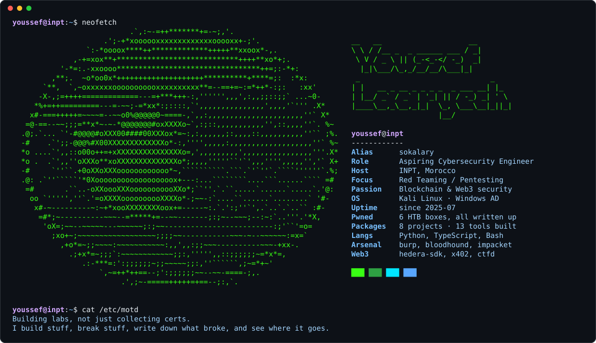
</p>

<p align="center">
  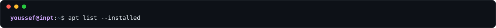
</p>

<p><code>offense</code>&nbsp;
             
</p>

<p><code>active directory</code>&nbsp;
      
</p>

<p><code>defense & vuln mgmt</code>&nbsp;
       
</p>

<p><code>frameworks</code>&nbsp;
  
</p>

<p><code>web3</code>&nbsp;
   
</p>

<p><code>build</code>&nbsp;
                  
</p>

<p><code>data & ml</code>&nbsp;
       
</p>

<p><code>platforms & workflow</code>&nbsp;
       
</p>


---

---

<p align="center">
  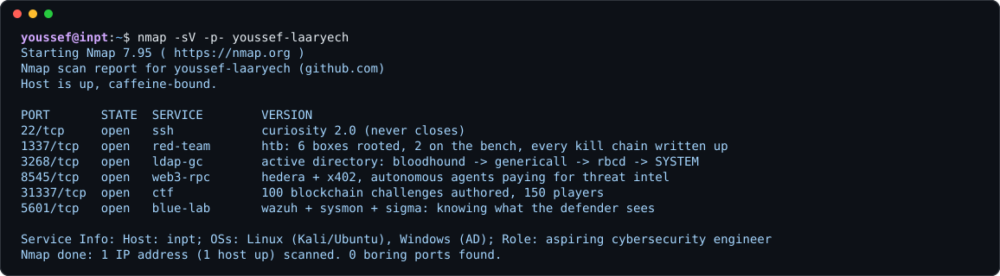
</p>

---

<p align="center">
  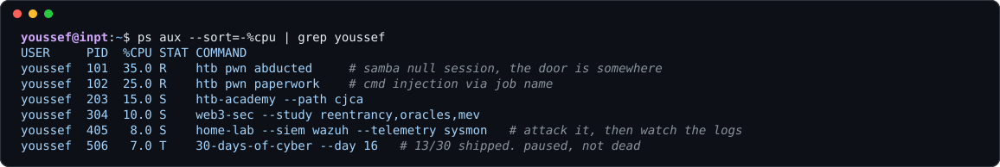
</p>

---

<p align="center">
  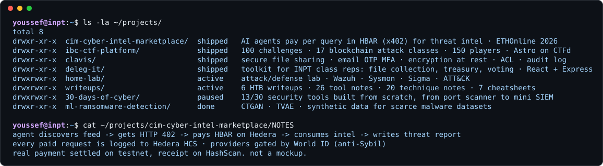
</p>

> `xdg-open` →
> [CIM](https://github.com/zayd-mzn/ethonline2026) ([live demo](https://ethonline-dun.vercel.app/) · [showcase](https://ethglobal.com/showcase/cim-uvx7x) · [on-chain proof](https://hashscan.io/testnet/transaction/0.0.7162784@1788996589.198259785)) ·
> [Deleg-IT](https://github.com/Youssef-Laaryech/Deleg-IT) ·
> [Writeups](https://github.com/Youssef-Laaryech/writeups) ·
> [30 Days of Cyber](https://github.com/Youssef-Laaryech/30-days-of-cyber) ·
> [Ransomware ML](https://github.com/Youssef-Laaryech/ransomware-data-augmentation)

---

<p align="center">
  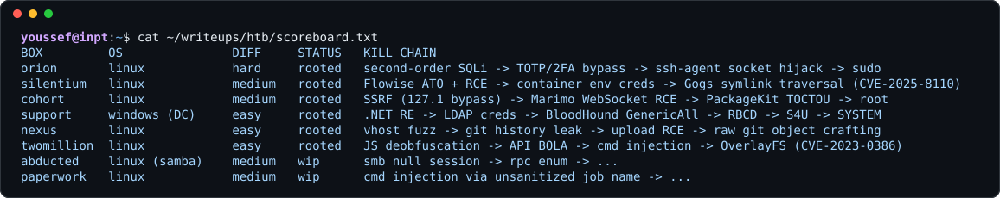
</p>

> `xdg-open` → [writeups & Cybervault](https://github.com/Youssef-Laaryech/writeups), an Obsidian vault written like a field manual

---

<p align="center">
  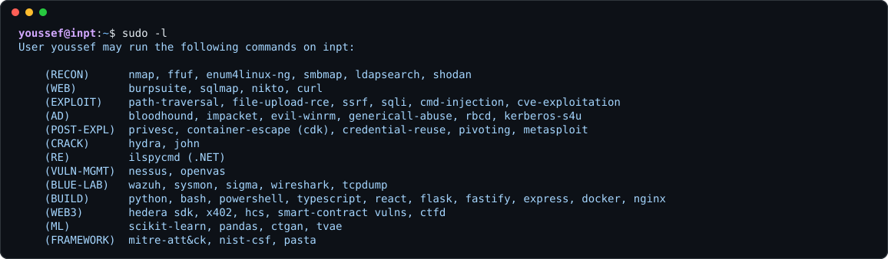
</p>

---

<p align="center">
  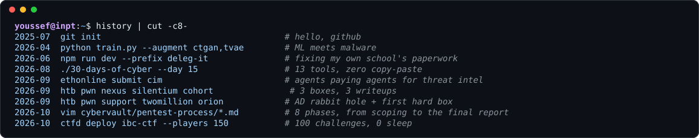
</p>

---

<p align="center">
  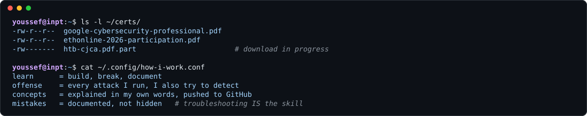
</p>

> `xdg-open` → [ETHOnline 2026 certificate](certificates/ETHOnline2026/ethonline2026-youssef-laaryech-certificate.pdf)

---

<p align="center">
  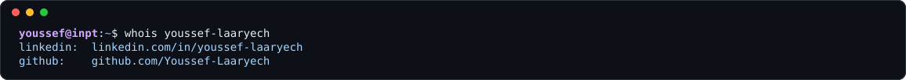
</p>

[](https://www.linkedin.com/in/youssef-laaryech)
[](https://github.com/Youssef-Laaryech)
[](https://github.com/Youssef-Laaryech/writeups)

<p align="center">
  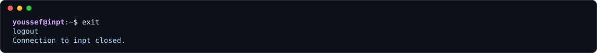
</p>
